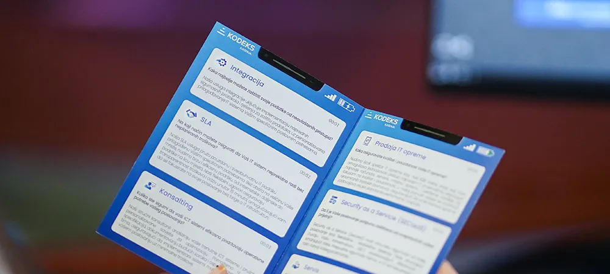

# Kodeks kejs.

Neki izazovi su previše dobri da bismo ih odbili. KODEKS je jedan od njih.

## Brief

Kad smo otvorili KODEKS kejs i napravili početnu analizu – znali smo da ulazimo u nešto ozbiljno (spooky muzika u pozadini ).

Ok. Već imamo izazov: IT kompanija koja ne priča s krajnjim korisnikom, ali ipak treba glas koji će je predstaviti.

**Kreću pitanja bez jednostavnih odgovora:**
- Kako prikazati njihovu stručnost na način koji rezonira?
- Kako izbjeći klasičnu prodajnu priču?
- Kako pričati o KODEKSu na način koji nije suhoparan?
- Kako pokazati njihovu stručnost, a da ne zvuči kao tehnički priručnik?
- I, ono najjednostavnije, kako ispričati priču koja će rezonirati čak i kad ne prodaje direktno?

Počeli smo slagati slagalicu u kojoj ton, vizuelni identitet, sadržaj, strategija i način komunikacije moraju kliknuti kako bi priča imala smisla i ostavila trag.

## Tragovi: kako smo startali?

KODEKS je godinama bio sinonim za računarsku opremu. Međutim, ispod te etikete krila se kompanija s ozbiljnim digitalnim rješenjima. Problem? To niko nije znao. Njihova online komunikacija nije dovoljno reflektovala ono što KODEKS jeste – tim vrhunskih profesionalaca koji kreiraju digitalna rješenja.

**Zadatak je bio jasan:**
- Redefinisati digitalni identitet KODEKSa.
- Istaknuti stručnost, a izbjeći suhoparne tehničke termine.
- Ojačati prisustvo na online kanalima.

**Metodologija: kako smo riješili slučaj?**

Redefinisanje strategije – postavili smo strateški okvir koji jasno definiše KODEKS na digitalnim platformama.

## Šta to znači?

Redefinisali smo ton komunikacije. Oblikovali smo ga precizno – cilj je bio da bude dovoljno ozbiljan da reflektuje stručnost, ali isto tako dinamičan i prilagođen pravoj publici. Bez suvišnog formalizma, ali s jasnim autoritetom. Potrudili smo se da se fokusiramo na edukativni sadržaj, ali bez uspavljujućeg efekta.

Sadržaj smo postavili kao strateški alat – jasan, relevantan i direktan. Edukativan tamo gdje treba, dinamičan da drži pažnju i uvijek prilagođen publici kojoj se obraćamo. Bez generičkih fraza (ako nađete neku – prijavite). Fokus je na ljudima, jer iza svakog rješenja stoje ljudi koji ga stvaraju. Sounds simple? Hmm, mišljenja smo da se danas stručnost, posvećenost i pravi tim lako uzimaju zdravo za gotovo. Zato je stavljanje njih u prvi plan bilo – naš plan.

## Dokazi: šta smo implementirali?

- **Osvježili smo komunikaciju** na društvenim mrežama.
- Predstavili tim na način koji donosi **kredibilitet i povezanost** s publikom.
- **Dokumentovali i iskomunicirali** svaki događaj na kojem se KODEKS pojavio.
- Kreirali **content strategiju** koja gradi autoritet, a ne samo prisustvo.
- Osmislili i pokrenuli **hero content** koji stavlja stručnost KODEKSa u prvi plan.
- Strateški koristili LinkedIn za **B2B komunikaciju i pozicioniranje**.
- Kreirali **jedinstven vizuelni identitet** koji prati digitalnu transformaciju brenda.

I da, dizajnirali i isprintali brošuru koju možete skrolati.

## Zaključak: KODEKS danas

Dvije godine kasnije, KODEKS ima digitalni identitet koji jasno govori – mi smo ozbiljan igrač u IT industriji. Društvene mreže su žive, strategija je jasna, a brend je prepoznat u digitalnom ekosistemu.

A mi? Mi nastavljamo s novim izazovima.
